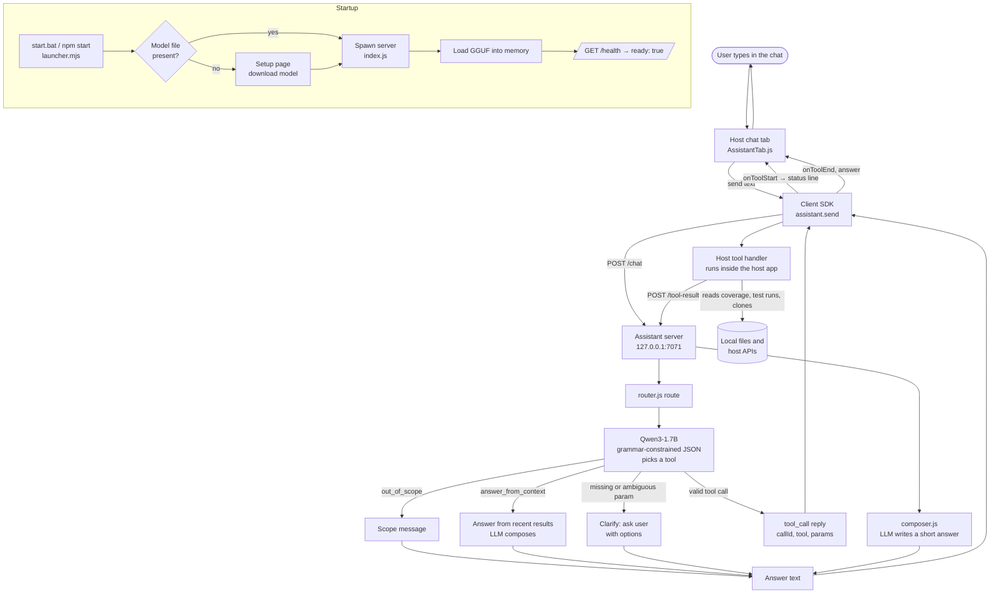

# How the AI Assistant works

This page explains which language model the assistant uses, how much memory it needs, and how a message travels from the user to the answer.

## 1. The language model

| Item | Value |
|---|---|
| Model | Qwen3-1.7B (quantized to Q4_K_M, GGUF format) |
| Runtime | node-llama-cpp (runs the model locally, no network calls) |
| Config | `server.config.yaml` → `model.file: models/Qwen3-1.7B-Q4_K_M.gguf`, `contextSize: 4096`, `gpu: auto` |
| Light option | Qwen3-0.6B-Q4_K_M.gguf (smaller and faster, for older computers) |

The model is used for two jobs:

1. **Routing.** It reads the user's message and picks one tool from the host application's list, or `out_of_scope`, `answer_from_context`, or a clarifying question. The output is forced into JSON by a grammar, so the choice is always valid.
2. **Answer writing.** It turns a tool's result into a short answer of at most five sentences, using only the data it was given.

## 2. Memory (RAM)

| Item | Estimate |
|---|---|
| Model file on disk | about 1.1 GB |
| Total RAM while running | about 2 GB free RAM (figure from the README, not measured here) |
| Light model | about 400 MB file, less RAM |

The 4096-token context adds some memory on top of the model file. To measure the real figure on a given machine, start the server and check the `node` process in Task Manager (Windows) or `top` (Linux/macOS).

## 3. Components

- **Host application** (for example, code-analyzer). It owns the data and the tools. Its chat tab shows messages and a status line. It registers tool handlers such as `run_unit_tests` or `get_coverage`.
- **Client SDK** (`packages/client/src/index.js`). It sends messages to the server, runs the tool handler when the server asks for one, and returns the final answer. It calls `onToolStart` and `onToolEnd` so the UI can show progress.
- **Assistant server** (`packages/server/`). It runs the model and the routing logic. It keeps a session per chat, with the last 10 turns and the last 3 tool results.
- **Setup and launcher** (`scripts/`). On first run it opens a setup page where the user downloads a model. After that it starts the server.

## 4. Flow chart

## 5. One message, step by step

1. The user types a question and presses Enter. The chat input is disabled while the assistant is busy, and a "Thinking…" line appears.
2. The SDK sends `POST /chat` with the session id and the message.
3. The server routes the message with the LLM. If the choice needs more information (for example, which app), it replies with `clarify` and the options. The user picks one and the flow continues.
4. For a tool call, the server replies `tool_call`. The SDK runs the matching handler in the host app and shows the tool's status text (for example, "Summing unit tests…").
5. The SDK posts the result to `POST /tool-result`. The server writes the answer with the LLM and replies `answer`.
6. The chat shows the answer. The session keeps the turn, so follow-up questions can use the recent results.

## 6. Limits and safety

- Everything runs on the local machine. The server makes no network calls at runtime.
- Messages are capped at 2000 characters. Request bodies are capped at 1 MB.
- Sessions expire after 120 minutes of inactivity.
- Answers that look like code are replaced with the scope message.
